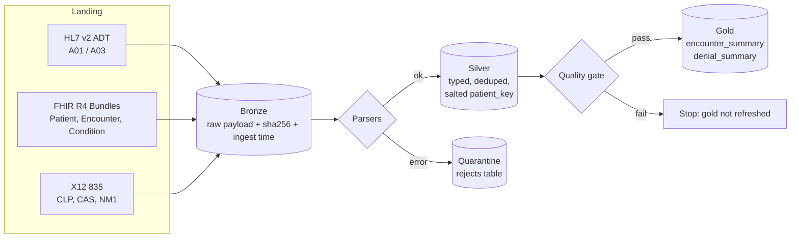

# healthcare-interop-lakehouse

Ingest HL7 v2 ADT messages, FHIR R4 bundles and X12 835 remittances into a bronze / silver / gold lakehouse, with pseudonymous patient keys, quarantine for bad records, and data-quality gates that stop gold tables from refreshing when checks fail.

> **Portfolio project, synthetic data only.** Every patient, identifier, payer and amount is randomly generated. This is an independent, clean-room example of the patterns I use in healthcare data engineering. It contains no code, data, schemas or configuration from any employer or client.

## Why this exists

Health-system analytics teams usually receive the same patient journey from three directions: real-time ADT feeds (HL7 v2), API extracts (FHIR R4) and payer remittances (X12 835). Each format needs its own parser, the identifiers must not leak past the secure zone, and finance and quality teams want answers such as *"which denial reasons cost us the most?"* and *"which encounters were 30-day readmissions?"*. This repo shows a compact, testable version of that pipeline.

## Architecture



| Layer | Tables | Rules |
|---|---|---|
| Bronze | `raw_payloads` | Append-only, sha256 de-duplication makes re-runs idempotent |
| Silver | `encounters`, `patients`, `conditions`, `claims`, `claim_adjustments`, `rejects` | Latest ADT event per visit wins; MRN replaced by salted SHA-256 key; names, addresses and DOB dropped (birth year kept) |
| Gold | `encounter_summary`, `denial_summary` | Length of stay, 30-day readmission flag (window over patient_key), denied dollars by CARC reason code |

## Tech stack

Python 3.10+, pandas (local runs), PySpark 3.5 (`spark_job.py`, Databricks-ready, Delta or Parquet output), pytest, GitHub Actions.

## Quick start

```bash
python -m venv .venv && source .venv/bin/activate
pip install -e ".[dev]"
cp config/.env.example .env && export $(cat .env)   # sets HC_LAKEHOUSE_SALT

hc-lakehouse generate --landing data/landing        # synthetic HL7/FHIR/X12 files
hc-lakehouse run --landing data/landing --out data/lake
pytest -q
```

Spark version (needs Java 17):

```bash
pip install -e ".[spark]"
python -m hc_lakehouse.spark_job --landing data/landing --out data/lake_spark
```

## Sample output

```text
DQ PASS   silver.encounters unique(visit_number) 0 duplicate rows
DQ PASS   silver.rejects reject_rate<=1% 0 rejected of 135
DQ PASS   silver.claims no_direct_identifiers found: []
{ "bronze_records": 135, "silver_encounters": 47, "silver_claims": 47,
  "gold_encounter_summary": 47, "gold_denial_summary": 6 }
```

`gold/denial_summary.csv` (synthetic):

| carc_code | denied_claims | denied_amount |
|---|---|---|
| 197 | 5 | 35523.0 |
| 16 | 3 | 27797.0 |
| 50 | 1 | 7325.0 |

## Project layout

```text
src/hc_lakehouse/
  parsers/hl7v2.py     HL7 v2 ADT parser (MSH, PID, PV1)
  parsers/fhir.py      FHIR R4 Bundle flattener
  parsers/x12_835.py   X12 835 claim payment parser (CLP, CAS triplets, NM1*QC)
  medallion.py         bronze/silver/gold with pandas
  spark_job.py         same contracts in PySpark (mapInPandas + window functions)
  quality.py           not-null, unique, accepted values, no-PHI-columns, reconciliation
  synthetic.py         reproducible synthetic data generator
  cli.py               `hc-lakehouse generate | run`
tests/                 22 tests (parsers, pipeline, PHI leakage, Spark parity)
```

## Security and PHI notes

- Raw MRNs never leave bronze. Silver and gold carry `patient_key = sha256(salt:mrn)`; the salt comes from an environment variable (a Databricks secret scope in production) and is never committed.
- `quality.no_phi_columns` blocks the run if a silver table contains name, MRN, DOB, address or phone columns, and a test scans every output for synthetic MRNs and surnames.
- Bad payloads are quarantined with the error, not dropped silently.
- The repo contains no credentials. `.env` is git-ignored.

## Limitations and next steps

- HL7 parsing covers the ADT fields used here; a production feed would sit behind an interface engine and handle repeating fields, escapes and Z-segments.
- The 835 parser does not explode service lines (SVC) or handle multiple ST/SE sets per file.
- Next: Delta Live Tables expectations version, Unity Catalog column masks, an Airflow DAG, and a dbt layer on top of gold.

## About this repository

Representative portfolio project published by Christin Ethan. The code was drafted with AI assistance (Claude) and is tested in CI on every push. MIT licensed.
